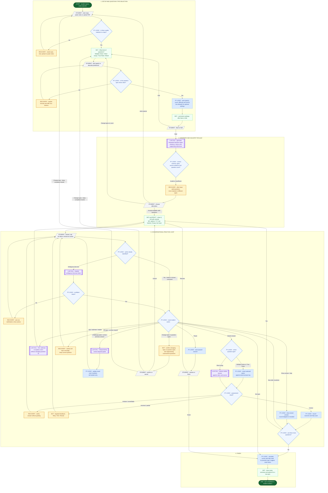

# AI Exam Prep Bot — Conversational workflow

This diagram is designed for the university project (React frontend + Python/FastAPI + LLM). It is intentionally detailed enough for implementation and for demonstrating repair/recovery in the course.

**START:** Student opens the bot. **END:** Bot displays a summary after the quiz is completed or ended early. A paused quiz can later resume.

**Legend:**

- **Purple, `LLM CALL`** — model invocation (question generation, short-essay grading, hints, ambiguous intent, grade review).
- **Blue, `PY LOGIC`** — deterministic backend routing, source validation, score recording, MC/true-false grading.
- **Yellow, `RECOVERY`** — repair path for errors, ambiguity or changes.
- **Grey slanted box, `STUDENT`** — user input or choice.
- **Green, `START` / `END`** — clear entry and exit points.

The bot asks for question format before generation, unless the student already specified it. Options are **Multiple choice**, **Short essay**, **True or false**, and **Mixed**. The Python backend preserves progress across clarifications, hints and format changes.

**Source file for Mermaid editors:** [`Exam_Prep_Bot_Workflow.mmd`](./Exam_Prep_Bot_Workflow.mmd).

**Detailed developer specification:** [`Exam_Prep_Bot_Conversation_Workflow_Developer_Handoff.md`](./Exam_Prep_Bot_Conversation_Workflow_Developer_Handoff.md).
